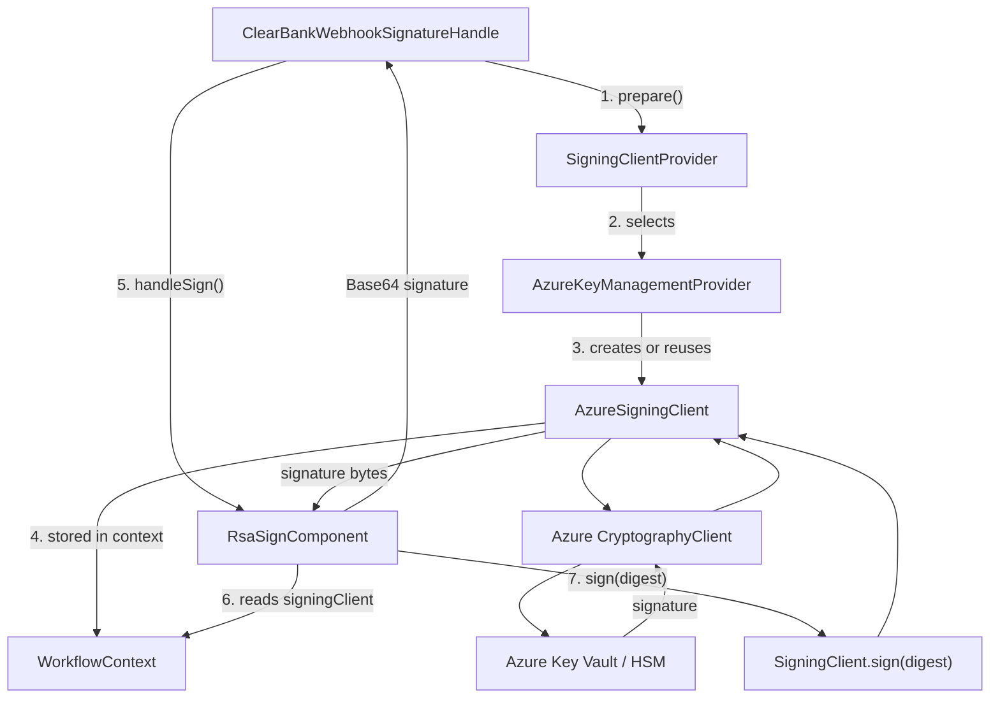

# Scenario1: KMS design - ClearBank exp



## Actual execution flow
### Phase A: Prepare the signing client
```text
ClearBankWebhookSignatureHandle
        |
        v
SigningClientProvider.prepare(...)
        |
        v
AzureKeyManagementProvider.prepare(...)
        |
        +---- Check L1 cache
        |       |
        |       +---- Cache hit: reuse client
        |       |
        |       +---- Cache miss: create client
        |                    |
        |                    v
        |             AzureSigningClient
        |
        v
WorkflowContext.variables["signingClient"]
```
### Phase B: Sign the webhook ACK
```text
ClearBankWebhookSignatureHandle
        |
        v
RsaSignComponent.sign(ackBody, workflowContext)
        |
        v
Read signingClient from WorkflowContext
        |
        v
SHA-256(ackBody)
        |
        v
SigningClient.sign(digest)
        |
        v
AzureSigningClient.sign(digest)
        |
        v
CryptographyClient.sign(RS256, digest)
        |
        v
Azure Key Vault / HSM
        |
        v
RSA Signature bytes
        |
        v
Base64 encoding
        |
        v
DigitalSignature HTTP header
```

## 3. Which design patterns are being used?

| Component                    | Design pattern / concept                 | Why                                                                               |
| ---------------------------- | ---------------------------------------- | --------------------------------------------------------------------------------- |
| `KeyManagementProvider`      | Strategy Pattern                         | Different key-management providers can implement different preparation strategies |
| `SigningClientProvider`      | Factory / Registry                       | Selects the appropriate provider and delegates client preparation                 |
| `AzureSigningClient`         | Adapter Pattern                          | Adapts Azure's CryptographyClient to your application's SigningClient interface   |
| `AzureKeyManagementProvider` | Cache                                    | Reuses previously created signing clients                                         |
| `WorkflowContext`            | Context passing / dependency propagation | Makes the prepared signing client available to the signing component              |

One important distinction: `SigningClientProvider` resembles a registry-backed factory, rather than necessarily being a classic GoF Factory Method implementation.


