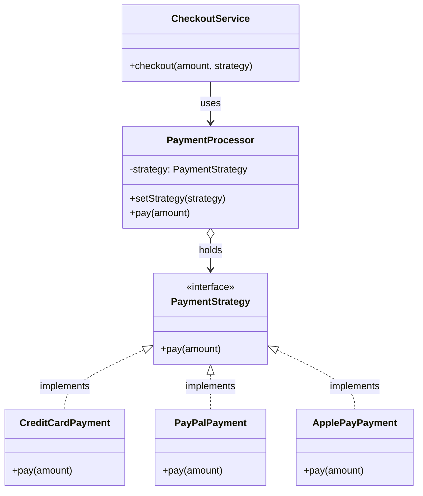

Ref:
- scenario: key management service
- simple Pseudocode: https://refactoring.guru/design-patterns/strategy
- chat: https://chatgpt.com/share/6af49350-4c7c-83e8-8baf-ad039b682639

# Scenario: Choose Your Wallet


### Understand each component

| Component           | Responsibility                           |
| ------------------- | ---------------------------------------- |
| `CheckoutService`   | Receives the customer's checkout request |
| `PaymentProcessor`  | Context; delegates payment execution     |
| `PaymentStrategy`   | Defines the common payment interface     |
| `CreditCardPayment` | Implements credit card processing        |
| `PayPalPayment`     | Implements PayPal processing             |
| `ApplePayPayment`   | Implements Apple Pay processing          |

Notice the most important relationship:

`PaymentProcessor` depends on the `PaymentStrategy` interface, NOT directly on `PayPalPayment`, `CreditCardPayment`, or `ApplePayPayment`.

That is what makes the strategies interchangeable.

## 2. Java project structure

Imagine the following file structure:

```
payment-system/
│
├── PaymentStrategy.java
│
├── CreditCardPayment.java
├── PayPalPayment.java
├── ApplePayPayment.java
│
├── PaymentProcessor.java
│
└── Main.java
```

## 3. Implement the Java classes

Step 1 — Define the Strategy interface

`PaymentStrategy.java`

```
public interface PaymentStrategy {
    void pay(double amount);
}
```

This interface defines a common contract.

Every payment method must implement `pay()`.

Step 2 — Implement concrete strategies

`CreditCardPayment.java`

```
public class CreditCardPayment implements PaymentStrategy {

    @Override
    public void pay(double amount) {
        System.out.println(
            "Paid $" + amount + " using Credit Card"
        );
    }
}
```

`PayPalPayment.java`

```
public class PayPalPayment implements PaymentStrategy {

    @Override
    public void pay(double amount) {
        System.out.println(
            "Paid $" + amount + " using PayPal"
        );
    }
}
```

`ApplePayPayment.java`

```
public class ApplePayPayment implements PaymentStrategy {

    @Override
    public void pay(double amount) {
        System.out.println(
            "Paid $" + amount + " using Apple Pay"
        );
    }
}
```

Notice that all three classes implement the same interface, but each provides its own payment implementation.

Step 3 — Implement the Context

`PaymentProcessor.java`

```
public class PaymentProcessor {

    private PaymentStrategy strategy;

    public void setStrategy(PaymentStrategy strategy) {
        this.strategy = strategy;
    }

    public void pay(double amount) {
        if (strategy == null) {
            throw new IllegalStateException(
                "Payment strategy not selected!"
            );
        }

        strategy.pay(amount);
    }
}
```

This is the core of the Strategy Pattern.

Look at this line:

```
private PaymentStrategy strategy;
```

It doesn't matter whether the actual object is:

- `CreditCardPayment`
- `PayPalPayment`
- `ApplePayPayment`

The `PaymentProcessor` only knows the interface.

And this line:

```
strategy.pay(amount);
```

Java automatically invokes the implementation belonging to the actual object.

This is polymorphism!

Step 4 — Implement CheckoutService

`CheckoutService.java`

```
public class CheckoutService {

    private final PaymentProcessor processor;

    public CheckoutService(PaymentProcessor processor) {
        this.processor = processor;
    }

    public void checkout(
        double amount,
        PaymentStrategy strategy
    ) {
        processor.setStrategy(strategy);
        processor.pay(amount);
    }
}
```

CheckoutService receives the selected strategy and passes it to the PaymentProcessor.

Step 5 — Run the application

`Main.java`

```
public class Main {

    public static void main(String[] args) {

        PaymentProcessor processor = new PaymentProcessor();
        CheckoutService checkout = new CheckoutService(processor);

        // Customer selects Credit Card
        checkout.checkout(100, new CreditCardPayment());

        // Customer selects PayPal
        checkout.checkout(200, new PayPalPayment());

        // Customer selects Apple Pay
        checkout.checkout(300, new ApplePayPayment());
    }
}
```

Output:

```
Paid $100.0 using Credit Card
Paid $200.0 using PayPal
Paid $300.0 using Apple Pay
```


